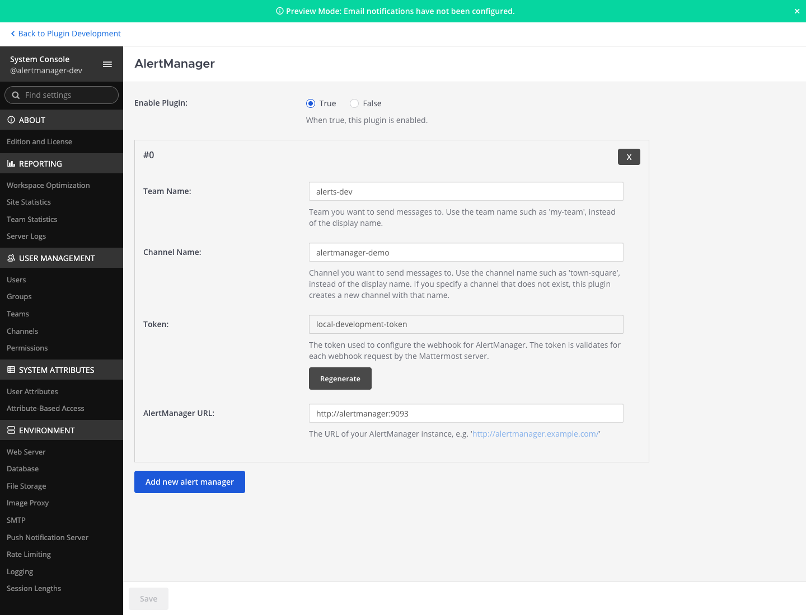
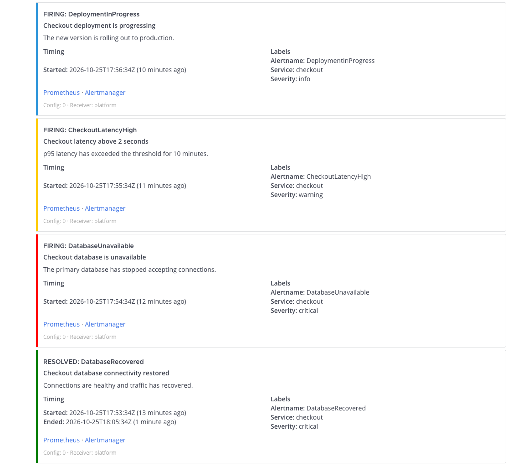
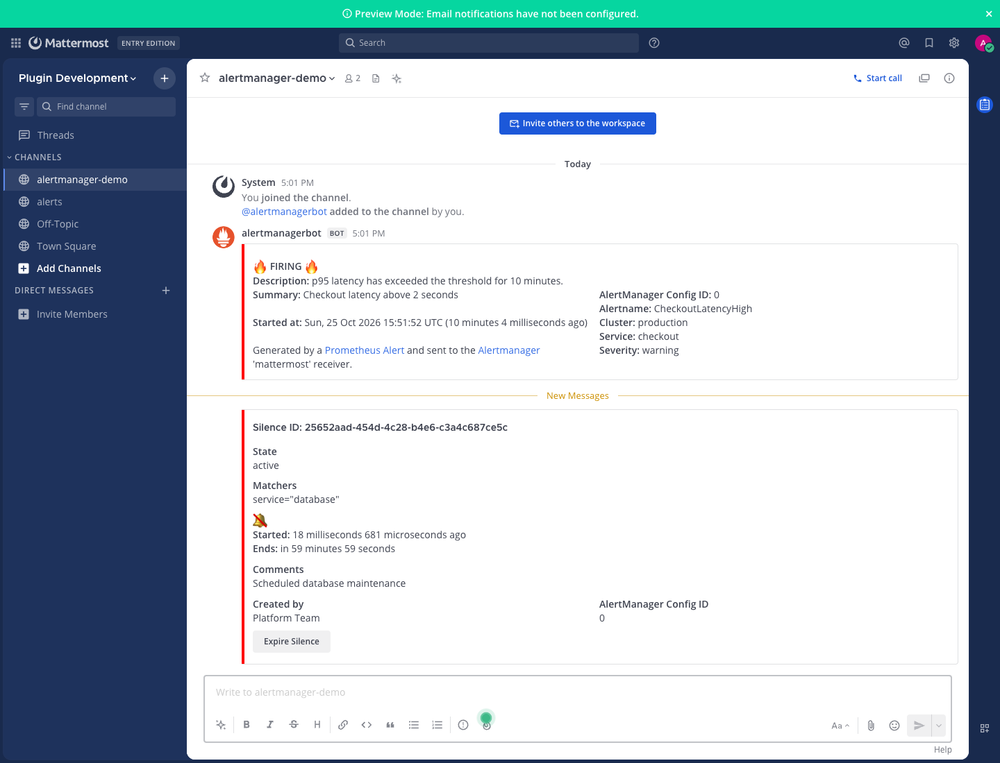

# Prometheus Alertmanager Plugin for Mattermost

Connect [Prometheus Alertmanager](https://prometheus.io/docs/alerting/latest/alertmanager/)
to Mattermost. Receive its webhooks, list alerts and silences, check
Alertmanager status, and expire silences using `/alertmanager` commands or buttons.
Supports multiple Alertmanager/channel configurations and creates a bot account.

Inspired by [alertmanager-bot](https://github.com/metalmatze/alertmanager-bot).

## Alert colors

Firing alerts use the `severity` label: `info` is blue, `warning` is yellow,
and `high` or `critical` is red. Values are case-insensitive. Missing or unknown
severities keep the default red. Resolved notifications are always green.

These colors apply to webhooks and `/alertmanager alerts`. Grouped webhooks keep
one message with a separate attachment for each alert, so every alert has its own
status and severity color. Each webhook attachment highlights the summary and
description above the labels and timing. Compact source links replace the old
“Generated by…” sentence; the configuration ID and receiver appear in the footer.

## Requirements

- Mattermost **11.7+** (the current ESR is the local development baseline).
- Go **1.27.0+**, Node **24.11+**, npm **10+** to build.
- Docker Compose v2 for the local integration environment.

The minimum server version has increased from 7.5. See the
[maintenance assessment](docs/maintenance.md) for SDK migration details, React
18/19 compatibility considerations, and the release checklist.

## Quick local test

Use a disposable local instance with no existing Mattermost on port 8065:

```sh
nvm install
make dev-up
make dev-setup
make dev-smoke
make dev-alert
```

`dev-up` starts PostgreSQL, Mattermost 11.7.14 and Alertmanager 0.34.1, waiting
for Mattermost to become healthy. The official Mattermost image uses amd64
emulation on Apple Silicon. The first start downloads the images and can take
several minutes.

`dev-setup` builds the bundle, creates a local administrator and team, uploads
and enables the plugin, and configures the `alerts` channel and webhook token.
It is fixed to `http://localhost:8065` and replaces the plugin's local settings.

Open <http://localhost:8065/alerts-dev/channels/alerts> and sign in:

- Username: `alertmanager-dev`
- Password: `Local-alertmanager-123!`

`dev-smoke` automatically verifies firing and resolved posts from the bot and
checks that the status, alerts and silences commands are accepted.

`dev-alert` sends a firing alert through Alertmanager API v2. Wait for its post
in the channel, then press Enter in the terminal to send the resolved update.
Try `/alertmanager status`, `/alertmanager alerts` and `/alertmanager silences`.
The Alertmanager UI is available at <http://localhost:9093>.

```sh
make dev-down     # stop containers and retain local data
```

To test another Mattermost version, set `MATTERMOST_VERSION` when starting the
stack, for example `MATTERMOST_VERSION=12.0.0 make dev-up`. Database upgrades
may prevent downgrading that same instance afterward; use fresh Docker volumes
when comparing different server versions.

## Automated checks and build

```sh
make test                     # Go tests with the race detector, including build tools
make check-style              # ESLint and golangci-lint v2.15.0
make dist                     # dist/alertmanager-0.5.0-rc.1.tar.gz
```

There are no automated web UI tests yet. The web build validates JSX/TypeScript
transpilation; manually exercise settings and the confirmation dialog before
releasing. Go tests cover webhook delivery failures, configuration startup,
label immutability, retries, delayed HTTP bodies and API v2 silence decoding.
CI runs Go tests, web lint, and the bundle build. Dependencies are installed
from the committed npm lockfile with `npm ci`.
The manually triggered **Local integration test** workflow runs the Docker smoke
test against Mattermost 11.7.14 and 12.0.0.

## Verify release artifacts

Releases built with Cosign 3 provide a `.sigstore.json` bundle containing the
package signature, signing certificate and transparency-log verification data.
Download it together with the plugin archive and checksums, then verify the
archive against the release workflow's identity. Set `PLUGIN_VERSION` to the
downloaded version without the `v` prefix:

```sh
PLUGIN_VERSION=x.y.z
shasum -a 256 -c "mattermost-plugin-alertmanager_${PLUGIN_VERSION}_checksums.txt"
cosign verify-blob \
  --bundle "alertmanager-${PLUGIN_VERSION}.sigstore.json" \
  --certificate-identity "https://github.com/cpanato/mattermost-plugin-alertmanager/.github/workflows/release.yml@refs/tags/v${PLUGIN_VERSION}" \
  --certificate-oidc-issuer https://token.actions.githubusercontent.com \
  "alertmanager-${PLUGIN_VERSION}.tar.gz"
```

The existing `v0.5.0-rc.1` release uses the earlier `.sig` and `.pem` files.
For that release, create a local verification bundle before running the
`verify-blob` command above:

```sh
PLUGIN_VERSION=0.5.0-rc.1
cosign bundle create \
  --artifact "alertmanager-${PLUGIN_VERSION}.tar.gz" \
  --signature "alertmanager-${PLUGIN_VERSION}.sig" \
  --certificate "alertmanager-${PLUGIN_VERSION}.pem" \
  --out "alertmanager-${PLUGIN_VERSION}.sigstore.json"
```

## Installation

1. Download a bundle from [releases](https://github.com/cpanato/mattermost-plugin-alertmanager/releases), or build it with `make dist`.
2. Enable plugin uploads on the server with `PluginSettings.EnableUploads=true` and restart Mattermost.
3. In **System Console > Plugins > Plugin Management**, upload the `.tar.gz` and enable the plugin.
4. Open **Plugins > AlertManager** and add a configuration with the team and channel URL names, Alertmanager URL, and a generated token. Save it.
5. Ensure `@alertmanagerbot` belongs to the target team and channel.
6. Configure the Alertmanager receiver using the same token:

```yaml
receivers:
  - name: mattermost
    webhook_configs:
      - send_resolved: true
        url: 'https://mattermost.example.org/plugins/alertmanager/api/webhook?token=YOUR_TOKEN'
```

The token is part of the URL; do not add extra quotes around its value.
Use a URL reachable from the Alertmanager container/server. Conversely, the
Alertmanager URL in plugin settings must be reachable from the Mattermost
server (the local stack uses `http://alertmanager:9093`).

For installation settings and signature requirements, see the official
[plugin management documentation](https://docs.mattermost.com/developers/integrate/plugins/using-and-managing-plugins).

## Plugin in action

The screenshots below use Mattermost 11.7.14, a local demo channel and sample alerts.

Configure the team, channel, token and Alertmanager endpoint:



Receive grouped notifications with a separate color and summary for each alert:



List active silences and expire one using its action button:


