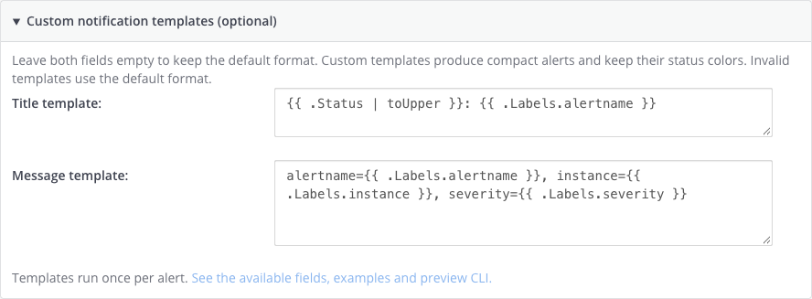
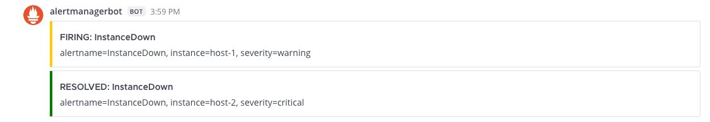

# Custom notification templates

In **System Console → Plugins → AlertManager**, expand **Custom notification
templates** for the destination you want to customize. Both fields accept Go
text templates and Mattermost Markdown:



- **Title template** replaces the attachment title.
- **Message template** replaces its body.

Leave both fields blank to keep the detailed default format. If either is set,
the destination uses compact attachments without the extra labels, timing,
source-link fields or footer. An omitted title or message retains its default
text. Status/severity colors remain automatic. Each alert in a grouped webhook
has its own attachment and its own status; a resolved member stays green even
when the overall webhook status is firing. Slash-command output is unchanged.

For a one-line summary, use this message template:

```gotemplate
alertname={{ .Labels.alertname }}, instance={{ .Labels.instance }}, severity={{ .Labels.severity }}
```

A title can include a summary or the current status:

```gotemplate
{{ .Status | toUpper }}: {{ .Annotations.summary }}
```

The rendered title and body also populate the attachment's `fallback` text for
clients that consume attachment fallbacks. Push-notification contents still
depend on Mattermost's server/client notification settings.

## Available data

Templates execute once per alert. The root represents that alert, rather than
the complete Alertmanager group:

| Field | Meaning |
| --- | --- |
| `.Status` | Individual alert status: `firing` or `resolved` |
| `.Labels`, `.Annotations` | This alert's label and annotation maps |
| `.StartsAt`, `.EndsAt` | Alert timestamps (`time.Time`) |
| `.GeneratorURL`, `.Fingerprint` | Alert source and fingerprint |
| `.Receiver`, `.ExternalURL` | Enclosing webhook's receiver and Alertmanager URL |
| `.GroupLabels`, `.CommonLabels`, `.CommonAnnotations`, `.RouteLabels` | Group metadata received in the webhook |
| `.ConfigID` | Plugin destination's configuration ID |

The alert is also accessible as `.Alert`. Credentials, tokens and plugin
configuration objects are not exposed. Missing map keys render as empty strings;
use `index .Labels "label-with-dashes"` for names that are not Go identifiers.

Go's template actions, pipelines, conditionals, named templates and built-in
functions are supported. Named templates must be defined in the same field or
file that uses them. The renderer also provides the functions from the
pinned Alertmanager version, such as `toUpper`, `toLower`, `title`, `join`, `date`,
`tz`, `match`, `reReplaceAll` and `humanizeDuration`. Use `.RouteLabels.name`
instead of Alertmanager's context-dependent `routeLabels` function. The `KV`
methods such as `.Labels.SortedPairs` are available as well. Text is rendered as
Markdown, without HTML auto-escaping; label and annotation values are data and
are not reinterpreted as template source.

Example with an optional runbook:

```gotemplate
{{ .Annotations.summary }}
{{ with .Annotations.runbook_url }}[Runbook]({{ . }}){{ end }}
```

## Validate and preview locally

The CLI uses the same parser, data and renderer as the plugin. It makes no
network calls and does not require Docker, Mattermost or Alertmanager to run.
From the repository root:

```sh
make template-preview
```

To test your own files:

```sh
go run ./cmd/alertmanager-template \
  -input examples/templates/webhook.json \
  -title-template examples/templates/title.tmpl \
  -message-template examples/templates/message.tmpl \
  -config-id preview
```

See the [CLI README](../cmd/alertmanager-template/README.md) for complete usage,
flags, output examples and exit codes.

The output is a JSON array of the rendered Mattermost attachments. Omit both
template flags to preview the default format. `-input -` (the default) reads
webhook JSON from stdin. The template-file flags contain paths; paste their file
contents into System Console. No files need to be installed on the server.

The CLI exits with a nonzero status on malformed JSON, invalid syntax or failed
execution, and emits no partial attachment JSON. The plugin logs template errors
with the configuration ID and uses the default format for the affected alert.
Invalid syntax falls back to defaults for that destination until the
configuration is corrected; other destinations continue independently.

Each template source and each rendered custom field is limited to 16 KiB. If both
title and message render empty, the plugin also falls back to the default alert.
Templates are compiled when configuration changes and reused concurrently.

See the [Alertmanager notification template reference](https://prometheus.io/docs/alerting/latest/notifications/)
for its data types and functions. These plugin templates are configured in
Mattermost, not in Alertmanager's `webhook_configs`.

## Example

Compact templates rendered on Mattermost 11.7.14, with one firing and one
resolved alert from the same webhook:


